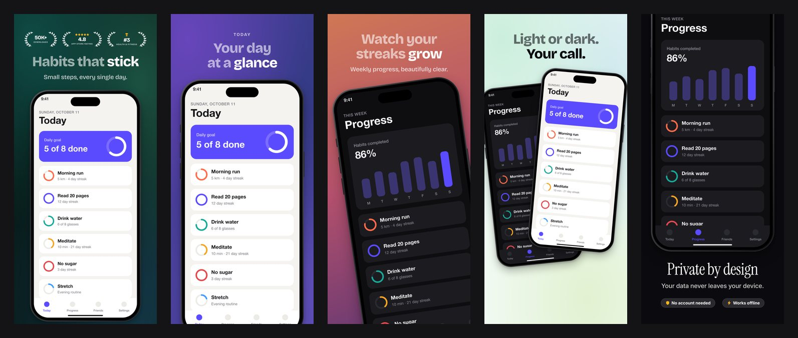

# appShots

Self-hosted App Store screenshot generator for iPhone and iPad. Describe the slides to your coding agent (copy, look, badges such as "10K+ downloads", a five-star rating or an award wreath), feed it screenshots straight from the simulator or a plugged-in iPhone, and get back PNGs at the exact sizes App Store Connect accepts. It also makes the wide images for App Store Connect's Header and Search Results tab.



It is four things:

| Piece | Where it runs | What it does |
| --- | --- | --- |
| Server | Docker or `npm start` | Renders slides, stores projects, serves the home page, the Studio (the editor in the browser), the REST API and the MCP endpoint at `/mcp` |
| MCP endpoint | Part of the server | Lets an agent create projects, write slides and render them |
| `appshots` CLI | Your Mac | Captures the simulator or a connected device and uploads the screenshot; a container cannot see your USB devices, so this part stays local. Also reaches the server's tools for agents without MCP |
| `appshots` skill | Your agent, on your Mac | Does the whole job in an app's repository: runs the app, captures the screens, writes the copy and builds the set. Works in Claude Code, Codex, OpenCode, Pi and anything else that reads a skill or follows a file |

## Run it locally

Needs Node 24 or newer.

```bash
npm install
npm run browser   # one-time download of the headless Chromium used for rendering
npm run build     # bundles the Studio and the home page into web/dist
npm start         # http://localhost:3000
```

The server runs straight from its TypeScript sources. Only the Studio (React, TanStack Router and TanStack Query, bundled by Vite) and the home page have a build step; run `npm run build` again after changing anything in `web/`. To work on the Studio with hot reload, run `npm run dev` and `npm run dev:web` side by side and open the address Vite prints.

Without the three sign-in settings (`GOOGLE_CLIENT_ID`, `GOOGLE_CLIENT_SECRET`, `ADMIN_EMAIL`) there is no sign-in, no home page and no accounts: whoever can reach the port works in the server's own space. That is fine on localhost and nowhere else. Set only one or two of them and the server refuses to start, so a typo cannot leave a deployed server open. The home page is also at `/home`, which is where to look at it while sign-in is off.

To run the container instead:

```bash
cp .env.example .env   # then fill in the sign-in settings
docker compose -f docker-compose.yaml -f compose.local.yaml up --build
```

The compose file always asks for the sign-in settings. For a local container, add `http://localhost:3000/auth/google/callback` to the OAuth client's redirect URIs and set `PUBLIC_URL=http://localhost:3000`.

## Deploy

1. Create the Google OAuth client described under [Sign in with Google](#sign-in-with-google).
2. Start the stack from this repository, with `docker-compose.yaml`.
3. Set `PUBLIC_URL` to the address people will use, for example `https://appshots.example.com`.
4. Set `GOOGLE_CLIENT_ID`, `GOOGLE_CLIENT_SECRET` and `ADMIN_EMAIL`, your own Google address. The stack refuses to start without them.
5. Give the `appshots` service a domain on port `3000`.

Everything lives in the `appshots-data` volume: projects, uploaded screenshots, renders, accounts and the key that signs sessions.

### Analytics

With `POSTHOG_KEY` set to a PostHog project token (`phc_…`), the home page and the Studio load PostHog and report page views and clicks. `POSTHOG_HOST` is the host it reports to, `https://us.i.posthog.com` unless set. The token is the public, write-only one that sits in the page source of any site using PostHog. The Studio shows people's unreleased apps, so session recording is switched off there whatever the PostHog project says, and nobody's name or email address is sent along.

`docker-compose.yaml` carries a default token for the author's own server. Running your own, set `POSTHOG_KEY` to your project's token, or to `off` for no analytics. Without the variable, as with `npm start`, the pages load nothing. Sign-in is open to others, so say in your privacy notice that the site counts visits.

### Docs, privacy policy and terms

The server has its own documentation at `/docs`, a privacy policy at `/privacy` and terms at `/terms`, all public. Each page is a Markdown file in [`docs/`](docs), drawn into the shell built from `web/docs.html`. The reference tables in them (layouts, fonts, icons, sizes) are filled in from the code, so they cannot fall behind it.

- Every page is also there as Markdown, at its address with `.md` on the end, and for a request that asks for `text/markdown`.
- `/llms.txt` lists the pages for language models, and `/llms-full.txt` holds all of them in one file.
- `/sitemap.xml` and `/robots.txt` are for search engines. They need `PUBLIC_URL` to carry the right address.

Set `OPERATOR_NAME` and `CONTACT_EMAIL` to put a name and a contact address on the privacy policy and the terms. Without them the pages say "the person who runs this server". Both pages are a starting point written for this software, not legal advice: read them, and change `docs/privacy.md` and `docs/terms.md` to fit who you are and where you are. The analytics section of the privacy policy appears only while `POSTHOG_KEY` is set.

To add a page, put `docs/<name>.md` there with a `title` and a `description` at the top, and add its name to `SECTIONS` in `src/site.ts`.

## People and accounts

Everybody signs in with Google. There are no passwords.

- **The admin** is the Google address in `ADMIN_EMAIL`. The admin is always let in, works in the server's own space without limits, and decides who else gets in. To hand the server to someone else, change the variable and redeploy.
- **Everyone else** gets a private space on their first sign-in: their own projects, screenshots, renders and API tokens. Nobody sees anybody else's work, the admin included.

Visitors who are not signed in see the public home page. Its **Open Studio** button (`/studio`) signs them in with Google and drops them in the Studio. Who that works for is set under **People** in the sidebar (admin only):

- **Anyone with a Google account** is the default: whoever finds the address can sign in and gets a space of their own. [What open sign-in costs](#what-open-sign-in-costs) says what that means for the machine.
- **Only the people listed here** closes it. Add the Google address of each person you want to let in; anyone else is turned away after choosing their Google account.
- **Remove** deletes a person's account with all of its projects, and takes them off the list. Their sessions and tokens stop working at once.

People manage their own tokens, or delete their account, under **Account**. Accounts other than the admin are capped at 20 projects and 40 screenshots per project and language (`USER_MAX_PROJECTS`, `USER_MAX_SHOTS`), and one account renders one set at a time.

**Renders are counted.** Every account other than the admin's gets 10 renders (`USER_RENDER_CREDITS`). One render is one export, whatever it draws; previews in the Studio are free, and a render that fails or is cancelled uses none. Each person sees how many are left in the sidebar. Under **People**, the button with that number sets a new one for an account. Deleting an account does not reset the count: the number of renders used is kept beside a hash of the Google account id, so signing up again gives the same count back.

### Sign in with Google

In [Google Cloud Console](https://console.cloud.google.com/apis/credentials) create an OAuth client of type "Web application" with:

- **Authorised JavaScript origin:** `<PUBLIC_URL>`, for example `https://appshots.example.com`
- **Authorised redirect URI:** `<PUBLIC_URL>/auth/google/callback`

Put its client ID and secret in `GOOGLE_CLIENT_ID` and `GOOGLE_CLIENT_SECRET`. appShots asks Google for the name and email address only, and accepts an address only when Google says it is verified.

While the OAuth consent screen is in "Testing", Google itself only lets in the test users listed there. Publish it ("In production") before inviting anyone else; the name and email scopes need no review by Google.

### What open sign-in costs

The server makes no paid calls. The agent runs on each person's own subscription, on their own machine, so more people cost nothing per use. What they use is this one machine:

- **CPU and memory.** A render drives a headless Chromium: about a second per slide on a recent Mac, more on a small server, and a few hundred megabytes of memory while it runs. Renders are queued one at a time for the whole server, so many people at once means waiting, not a bigger bill.
- **Disk.** This is what grows. An account can hold 20 projects of 40 screenshots per language, each up to 40 MB when uploaded, plus the rendered sets. A handful of people is nothing; a few hundred accounts filled to the cap would not fit on a small disk. Lower `USER_MAX_PROJECTS` and `USER_MAX_SHOTS` if the disk is small, and keep an eye on the volume.
- **Abuse.** Anyone can sign in, so somebody may script uploads or renders. The caps, the counted renders and the render queue bound the damage, and **Remove** under People deletes an account with everything in it.

If that is more than you want to carry, switch to **Only the people listed here** under People.

### Upgrading from a version with `APPSHOTS_TOKEN`

- `APPSHOTS_TOKEN` is no longer read. The projects it reached are the server's own space, which now belongs to the admin.
- Agents and the CLI need a personal token instead: sign in, open **Connect an agent**, create one, and run the command it shows.
- Accounts made with an email and a password, or through an invite link, are kept: the account and its projects come back on the first Google sign-in with the same address. Their old passwords and tokens are discarded.
- Sign-in is open to anyone with a Google account unless you picked the list under People or put somebody on it. A server that was invite-only is open after the upgrade; choose **Only the people listed here** to close it again.

## Connect an agent

**Connect an agent** in the Studio's sidebar asks which agent you use, then what it should do, and gives the steps with your token already filled in.

| Agent | Skill goes to | Start it with | MCP connection |
| --- | --- | --- | --- |
| Claude Code | `~/.claude/skills/appshots` | `/appshots` | `claude mcp add`, for every folder |
| Codex | `~/.agents/skills/appshots` | `$appshots` | `codex mcp add`, plus the token in `~/.codex/config.toml` |
| OpenCode | `~/.agents/skills/appshots` | Ask for the screenshots | `opencode mcp add --global` |
| Pi | `~/.agents/skills/appshots` | `/skill:appshots` | None: Pi has no MCP, the skill uses `appshots call` |
| Something else | `~/.agents/skills/appshots` | "Read `~/.agents/skills/appshots/SKILL.md` and follow it" | By hand, if the agent has MCP |

For each agent there are three ways to work:

| Way | What you do | What it sets up |
| --- | --- | --- |
| Do everything for me | Paste one command, then start the skill in your app's folder | The skill, the CLI and the MCP connection |
| Tell it what to do | Paste one command, add your screenshots, describe the set | The MCP connection |
| Make it by hand | Nothing | Nothing: you work in the Studio |

### One command for everything

```bash
curl -fsS https://appshots.example.com/install.sh | APPSHOTS_TOKEN=<token> sh -s codex
```

Connect shows this with a real token in place of `<token>` and your agent at the end: `claude` (also what you get with nothing after `sh`), `codex`, `opencode`, `pi` or `other`. It needs Node on the Mac, and does four things:

1. Checks the token against the server and saves it in `~/.config/appshots`.
2. Puts the CLI next to the skill and links it as `appshots` in `~/.local/bin`, `~/bin` or next to `claude`, whichever is on your PATH.
3. Installs the skill where that agent looks for skills.
4. Connects the agent to the server's MCP endpoint for every folder, with the agent's own command, replacing an older `appshots` entry.

Run it again whenever the token has been replaced, and once per agent if you use several; a copy set up for another agent is brought up to date at the same time. `install.sh`, the skill and the CLI hold no secrets, so the server hands them out without sign-in; the token is the only thing that opens anything.

The server hands out the skill and the CLI it was deployed with, so a deploy changes what a new setup installs. A Mac that was set up before catches up with one command, which needs no token and leaves the agent's connection alone:

```bash
appshots update
```

`appshots check` says when the server has a newer skill, and the skill tells the agent to run the update and read itself again. Installs from before `update` existed need the setup command once more.

Then open the agent in an app's repository, start a new session and start the skill, or just ask for App Store screenshots. The agent works the same way every time: it checks the setup, asks a handful of questions first (iPhone or iPad, where the screens come from, where the app runs, the look, any real ratings or logos to show), reads a little of the code to learn what the app does, gets the screens, writes the headlines, builds the set, looks at the render and fixes what is off. The skill's source is [skill/SKILL.md](skill/SKILL.md).

The screens come one of three ways, and the skill asks which: screenshots you already have (`appshots upload`), you open each screen and it is captured (`appshots shoot`, the quickest way to real content), or the agent starts the app on each screen itself (`appshots run` and `appshots launch`). It uses these commands for everything on the Mac and writes no scripts or UI tests of its own, which is what keeps a set to ten or twenty minutes.

### Only the MCP connection

```bash
claude mcp add --transport http --scope user appshots https://appshots.example.com/mcp --header "Authorization: Bearer <token>"
opencode mcp add --global --url https://appshots.example.com/mcp --header "Authorization=Bearer <token>" appshots
```

Codex takes no header on its command line, so use the setup command above for it, or add the server yourself in `~/.codex/config.toml`:

```toml
[mcp_servers.appshots]
url = "https://appshots.example.com/mcp"
http_headers = { Authorization = "Bearer <token>" }
```

Then ask in plain words, for example:

> Make App Store screenshots for my habit tracker in project "streaks". Six slides, dark purple look, open with a hero slide with a laurel badge "4.8 · App Store rating" and one for "50K+ downloads", then one slide per feature using the screenshots home, stats and widgets.

The agent answers with a contact sheet of the rendered set, a link to the Studio and a ZIP link. Tools: `get_design_guide`, `list_projects`, `create_project`, `get_project`, `update_project`, `set_slides`, `update_slide`, `set_creative_assets`, `render`. Every tool works inside the space the token belongs to.

The endpoint is Streamable HTTP and authenticates with a bearer header, so it works with any client that can send one. It does not implement OAuth.

### Without MCP

The CLI reaches the same tools, for Pi and any other agent that can run a command but has no MCP:

```bash
appshots tools                                    # every tool and its arguments
appshots tools set_slides                         # one tool's arguments in full
appshots call create_project '{"name": "Streaks"}'
appshots call set_slides @slides.json             # arguments from a file, or - for stdin
appshots call render '{"project": "streaks"}'     # pictures a tool returns are saved, and the paths printed
```

The skill uses these by itself when the session has no working `appshots` MCP server.

## Capture from your Mac

The setup command above installs the CLI. It is one file with no dependencies, so in a checkout it also runs as `node cli/appshots.mjs`, or as `appshots` after `npm link`; `appshots setup <url> --agent <agent>` does what the setup command does.

```bash
appshots check                                    # the server, the skill, Xcode, the project here, simulators,
                                                  # installed apps and devices, each with what to do next
appshots upload streaks ./screens                 # screenshots you already have: files, or a folder of them
appshots upload streaks logo.svg mascot.png --image   # a logo and other artwork for the slides, not screenshots
appshots run                                      # build the app in this folder and launch it in a simulator
appshots run --ipad --dark --lang de              # on the 13-inch iPad Pro, dark, in German
appshots launch com.example.streaks --lang de-DE --capture stats --to streaks -- -appshots stats
                                                  # the same screen in German, filed as the German "stats"
appshots upload streaks ./screens-de --lang de-DE # screenshots you already have in another language
appshots run --duo                                # on the iPhone Duo
appshots launch com.example.streaks --capture stats --to streaks -- -appshots stats
                                                  # start an installed app again with launch arguments,
                                                  # capture the screen and upload it, in one command
appshots shoot streaks home stats detail --clean  # you open each screen and press Return; it captures and uploads
appshots capture --name home --project streaks    # from the booted simulator, uploaded straight away
appshots capture --name home --device --project streaks   # from the plugged-in, unlocked iPhone or iPad
appshots capture --name home --clean              # simulator only: 9:41, full battery and signal
appshots simctl openurl booted "streaks://stats"  # simctl with the right Xcode, for deep links and the like
appshots devices                                  # booted simulators and connected devices
appshots pull streaks --render                    # render everything and unpack it into ./store-screenshots/streaks,
                                                  # header and search results assets included
appshots update                                   # the skill and the CLI as the server has them now
appshots login https://appshots.example.com       # only the token, without the skill or the MCP connection
```

The `--name` is what slides refer to (`"screenshot": "home"`). Capturing the same name again replaces the screenshot, and every slide using it updates. An iPhone and an iPad screenshot can share a name; each target size picks the matching one.

A project in several languages holds each screenshot once per language under the same name: `--lang <code>` on `capture`, `upload`, `run` and `launch` says which one it is, and has to name one of the project's languages. Without it a screenshot is for the first language, and every other language shows that one until it has its own.

`appshots run` finds the workspace or project and its scheme, boots the simulator the store sizes ask for (iPhone Pro Max, the 13-inch iPad Pro with `--ipad`, or the iPhone Duo with `--duo`), and builds in Xcode's own build folder, so a project Xcode has built already starts in seconds. `--fresh` builds in a folder of its own instead. What follows a lone `--` goes to the app as launch arguments.

Simulator capture uses `simctl`. Device capture uses `devicectl device capture screenshot`, which needs Xcode 27 or newer and a device that is unlocked and trusts the Mac. If `xcode-select` points at the Command Line Tools, the CLI switches to `/Applications/Xcode.app` by itself.

## The Studio

Open the server in a browser and sign in to see every slide as a live preview at export size, and download the set as a ZIP. Changes an agent makes through MCP show up in an open Studio within a few seconds.

- **Projects** sit in the sidebar. **Rename** and **Delete** are beside the project's title, which can also be clicked and typed over, and under the three dots next to every project in the sidebar. Renaming keeps the project's address, so links to it go on working.

- **Languages.** A new project asks for its languages. The switch beside the slides picks the one the page shows, which is also the one you type and upload for, and **+ Language** adds another. A language shows the first one's texts and screenshots until it has its own; **Project → Languages** removes one or makes another the first.
- **Slides.** The heading of the section switches between iPhone, iPhone Duo and iPad. Click a slide to edit it: the editor opens beside a large preview of that slide, with the layouts as small sketches, the screenshots as thumbnails to pick from (two or three for the layouts that take several), sliders for the device's size, position and tilt, and editors for feature cards or points, badges, and the row of icons or logos.
- **Screenshots.** Drop files anywhere on the page, or use the upload button.
- **Logos and images.** Everything else a slide can show: your logo or app icon, a mascot, stickers, shapes. Upload PNG, SVG, JPEG or WebP files there, or drop them on that section. Click one to place it on the selected slide, then drag it in the large preview; size, turn, opacity, shadow, mirroring and whether it lies over or under the device are in the slide's editor, with ready arrangements for several images at once. A slide's logo is picked under **Your logo**.
- **Header and search results.** Adds, previews and edits the three store assets. **Show safe area** draws the part every device shows as a dashed frame; it is off until you tick it and never in the exported file.
- **Light and dark.** The switch at the bottom of the sidebar picks **Light**, **Dark** or **Auto**, which follows the device. The home page has the same choice as a button in its header, and the browser remembers it.

## Slides

A project has a theme and up to ten slides. Every style field can be set on the theme and overridden per slide.

- **Layouts:** one device (`device-bottom`, `device-top`, `device-center`, `tilted`, `closeup`, `floating`, `hero` with badges above the headline), the device beside a column of copy (`device-right`, `device-left`), several devices (`duo` and `side-by-side` take `screenshot` and `screenshot2`, `trio` takes `screenshot3` as well), and `features`, which has no device at all
- **Feature slides:** the `features` layout lists up to six things the app does as cards with an icon or a figure, a title and a line of text, in the styles `bento`, `grid`, `cards` or `list`
- **Feature points:** on every other layout, `features` is a short list next to the headline, as `list`, `cards`, `grid` or `chips`. It goes best with `device-right` and `device-left`, which give the copy a column of its own
- **Badges** (up to four per slide): `laurel` (wreath), `stars`, `rating` (the figure with five stars), `review` (a quote with its author), `icon`, `pill`; plain or in `gold`
- **Icon and logo rows:** `iconRow` puts up to eight icons or logos under the copy with an optional label such as "Works with", as `tiles`, `circles` or `plain`, in the brands' own colours, the accent or the text colour
- **Logo:** `logo` puts an uploaded image over the headline, `small`, `medium` or `large`, as it is (`plain`), as an iOS app icon with rounded corners (`app-icon`) or as a `circle`
- **Images:** `images` places up to ten uploaded images anywhere on a slide, each with its position and width in percent of the canvas, and optionally a turn, a shadow that follows its outline, an opacity, mirroring, and whether it lies in front of the device and the copy or behind them
- **Icons:** 199 of them for badges, features and rows, 43 of which are logos of services such as YouTube, Instagram, Spotify, Slack and Notion. They are the fill weight of [Phosphor Icons](https://phosphoricons.com) (MIT); `npm run icons` rebuilds `src/icons.ts` from the list in `scripts/icons.mjs`
- **Backgrounds:** presets (`midnight`, `aurora`, `ember`, `ocean`, `sunset`, `candy`, `forest`, `graphite`, `peach`, `mint`, `lavender`, `sky`, `paper`, `ink`), `auto` (colours taken from the slide's screenshot), a hex colour, or a custom `{type, colors}` gradient or mesh
- **Fonts:** 41, bundled, so nothing is fetched at render time:
  - Sans: Inter, Manrope, Plus Jakarta Sans, DM Sans, Outfit, Figtree, Geist, Onest, Urbanist, Lexend, Montserrat, Rubik, Red Hat Display, Archivo, Sora, Space Grotesk
  - Rounded: Nunito, Quicksand, Fredoka, Baloo 2
  - Display: Bricolage Grotesque, Unbounded, Syne, Oswald, Anton, Bebas Neue, Archivo Black
  - Serif: Fraunces, Playfair Display, Lora, Newsreader, Cormorant, Roboto Slab, Instrument Serif, DM Serif Display, Young Serif
  - Handwritten: Caveat, Pacifico, Permanent Marker
  - Mono: JetBrains Mono, Space Mono

  Faces that only work large, such as the handwritten ones, set the headline; the small print beside them is set in a plain face that goes with them
- **Device:** frame (`auto`, `iphone`, `duo`, `ipad`, `none`), colour and shadow, and per slide its size (`scale`), place (`offsetX`, `offsetY`), tilt (`rotate`) and turn in 3D (`perspective`). With two or three devices, `spread` is the angle between them and `gap` their distance
- **Device look:** `style` draws the frame as the device looks (`real`), in one matte colour (`clay`), as a line drawing (`outline`) or as one drawn by hand (`sketch`)
- **Status bar:** `statusBar` draws a clean one, with the time, full signal, Wi-Fi and a full battery, over the one a screenshot came with (`cover`) or onto a screenshot that has none (`overlay`); `statusBarTime` and `statusBarColor` set what it shows
- **Text:** `*asterisks*` tint words with the accent colour, a newline forces a break, and any text can be a `{ "en-US": "...", "de-DE": "..." }` map for localized sets

### Output sizes

A set is designed once per device (iPhone, iPhone Duo, iPad) and exported at the exact size of every display App Store Connect lists. Sizes of the same shape are one picture drawn at the largest size and scaled, so they look alike everywhere.

| Folder | Pixels | Display in App Store Connect | Exported |
| --- | --- | --- | --- |
| `iphone-6.9` | 1320×2868 | iPhone with Dynamic Island (large display) | always |
| `iphone-6.3` | 1206×2622 | iPhone with Dynamic Island (medium display) | always |
| `iphone-6.5` | 1284×2778 | iPhone with Face ID (large display) | always |
| `iphone-6.1` | 1170×2532 | iPhone with Face ID (medium display) | always |
| `iphone-duo` | 2007×2853 | iPhone Duo | with Duo screenshots |
| `ipad-13` | 2064×2752 | iPad 13" display | with iPad screenshots |
| `ipad-11` | 1668×2420 | iPad 11" display | with iPad screenshots |
| `iphone-5.5`, `iphone-4.7`, `iphone-4`, `iphone-3.5` | 1242×2208, 750×1334, 640×1136, 640×960 | iPhone with Home Button | when chosen |
| `iphone-duo-cover` | 1398×2034 | iPhone Duo | when chosen |
| `ipad-12.9`, `ipad-10.5`, `ipad-9.7` | 2048×2732, 1668×2224, 1536×2048 | older iPads | when chosen |

Choose other sizes under **Project → Export sizes** in the Studio or with `targets` on the project. Files are opaque PNGs laid out as `<locale>/<target>/01.png`, and the ZIP has a `README.txt` that says which folder goes onto which display.

A raw screenshot counts as iPhone Duo when it is exactly 2007×2853 or 1398×2034, as iPhone when it is narrow, and as iPad otherwise. `--as iphone|duo|ipad` on upload, or the menu on its thumbnail in the Studio, overrides that.

## Header and search results assets

App Store Connect has a **Header and Search Results** tab under Product Page Information. An image uploaded there is shown at the top of the product page, or with the app in search results, on iOS 27 and iPadOS 27 or later. Both are optional and set per language; without them the store keeps using screenshots in those places.

A project can hold one of each, built from the same screenshots and theme as its slides:

| Asset | Size | Safe area | Used for |
| --- | --- | --- | --- |
| `header` | 3840×1646 (21:9) | 1646×661 at 1097, 493 | The product page header |
| `search` | 3840×2560 (3:2) | 2168×1030 at 836, 765 | The search results asset |
| `universal` | 5244×2950 (16:9) | 1402×962 at 1921, 660 | One file for both; it is what "Use header asset in search results" expects |

The store crops these images differently on each device and orientation, and only the safe area is always visible. appShots therefore centres the copy and shrinks it until it fits inside that area, and treats everything around it as decoration that may be cut off. The previews an agent gets draw the safe area as a dashed frame, and the Studio does when **Show safe area** is ticked; the exported PNG never contains it.

- **Layouts:** `fan` (copy above up to five fanned devices), `sides` (copy between up to four devices), `wall` (copy over a dimmed wall of bare screenshots). Without screenshots an asset is copy on the background, without copy it is the devices alone.
- **Per asset:** eyebrow, headline, subheadline, up to six screenshots in order of importance, up to three badges, the app's own logo over the headline, background, font, colours, headline size, and the device frame, look, colour, size, shadow and status bar. What an asset leaves out comes from the project theme.
- **Output:** opaque PNGs at `<locale>/creative-assets/header.png`, `search.png` and `universal.png`, rendered with the slides and included in the ZIP.

Apple reviews these images and asks for more restraint than in screenshots: one clear idea, a short phrase at most, no prices, discounts, web addresses or copyright symbols, no logos of other platforms, no claims or awards that cannot be verified and no Apple accolades (Editors' Choice, App of the Day, Apple Design Award), and text translated for every language it is uploaded for. See Apple's [creative asset specifications](https://developer.apple.com/help/app-store-connect/reference/app-information/creative-assets-specifications/).

Apple publishes the safe areas as a design template, not as numbers. The values above are measured from that template, so check each asset in App Store Connect's preview before submitting. The video variants of these assets are not generated.

## REST API

Everything the Studio and the CLI do goes through `/api`, with the same bearer token. A token only ever reaches the projects of the space it belongs to.

```
GET    /api/projects                       list
POST   /api/projects                       create {name, locales?, targets?, theme?, slides?}
GET    /api/projects/:id                   project, screenshots, images, rendered files
PUT    /api/projects/:id                   update {name?, locales?, targets?, theme?, slides?, creatives?: {header?, search?, universal?}}
DELETE /api/projects/:id
PUT    /api/projects/:id/shots/:name       upload a screenshot (raw image body, ?device=iphone|duo|ipad to override detection,
                                           ?locale=de-DE for one language only)
PATCH  /api/projects/:id/shots/:file       {device?, locale?} files it under another device or language (locale null: the first)
DELETE /api/projects/:id/shots/:file
PUT    /api/projects/:id/images/:name      upload a logo or other artwork (raw PNG, SVG, JPEG or WebP body)
DELETE /api/projects/:id/images/:file
POST   /api/projects/:id/render            {targets?, locales?, slides?, creatives?, background?}; without targets, every size the
                                           project exports. background: true answers 202 with a job instead of waiting
GET    /api/renders                        the account's renders of the last hour, and rendersLeft
GET    /api/renders/:job                   one of them: state, done, total
DELETE /api/renders/:job                   cancels one that is waiting or running
GET    /api/projects/:id/export.zip        ?render=1 renders first
```

A render without `slides` and `creatives` produces everything. `slides` (zero-based indexes) or `creatives` (`header`, `search`, `universal`) narrow it to those, and `"creatives": []` renders the slides alone.

The Studio renders in the background: **Export ZIP** starts a job, the sidebar shows its progress, and the ZIP downloads when it is done, so the page stays free meanwhile. A job draws the project as it was when it was asked for. Jobs live in memory, so one that is cut off by a restart has to be started again; it is not counted.

Account settings and the People page need a browser sign-in; an API token cannot create more tokens or manage people.

## Good to know

- Screenshots are portrait only; there is no landscape or Apple Watch/TV output.
- Put only real figures, reviews and awards in badges. App Review rejects screenshots with invented download counts, ratings or rankings.
- Logos are other companies' trademarks. Show them only for services the app really works with, and none in the header and search results assets, where Apple does not allow them. The same goes for images you upload: your own logo and artwork, not somebody else's.
- Uploaded images are kept as PNGs of at most 2048 pixels a side; an SVG is drawn once when it is uploaded.
- The device frames are drawn in CSS, not Apple's product images.
- Put the server behind HTTPS. No passwords are stored. `accounts.json` on the data volume holds each person's name, email address, Google account id and number of renders, the list of allowed addresses, and API tokens as SHA-256 hashes; a token is shown once when it is created.
